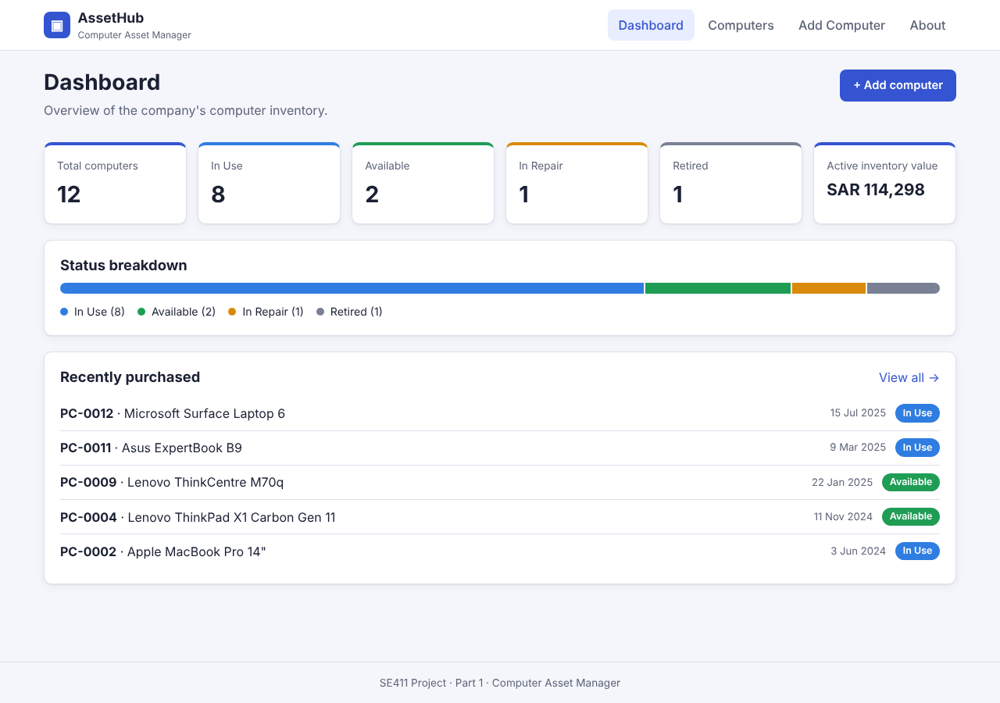

# AssetHub: Computer Asset Manager

SE411 Project, Part 1. A React app for managing a company's computers (laptops, desktops, workstations, servers and tablets).



## Team

| Name | Student ID |
|------|------------|
| Sultan Almojel | 222110274 |
| Ziyad AlIsmail | 222110392 |
| Nawaf AlTamimi | 222110323 |
| Saud Alnasser | 222110253 |

## Features

- **Navigation menu**: Dashboard, Computers, Add Computer, About.
- **Display**: a dashboard with inventory statistics and a table listing every computer, plus a details page for each one.
- **Add**: a validated form for registering a new computer. The next free asset tag is filled in for you.
- **Update**: edit any computer using the same form.
- **Delete**: remove a computer after confirming in a dialog.
- **Search**: free-text search across tag, brand, model, serial, employee and department. You can also filter by status and type and sort the results. Filters are kept in the URL.
- **About page**: lists the team members with their student IDs.

Part 1 has no database. The data is a collection of JavaScript objects kept in memory (`src/data/initialComputers.js`), so changes reset when you reload the page.

## Getting started

You need [Node.js](https://nodejs.org) 20 or newer.

```bash
git clone https://github.com/222110274-sudo/SE411-Project.git
cd SE411-Project
npm install
npm run dev        # open http://localhost:5173
```

| Command | What it does |
|---------|--------------|
| `npm run dev` | Start the development server |
| `npm test` | Run the test suite once |
| `npm run test:coverage` | Run the tests and print a coverage report |
| `npm run lint` | Lint the code with Oxlint |
| `npm run build` | Build for production into `dist/` |

## Documentation

- [Requirements](docs/REQUIREMENTS.md): functional and non-functional requirements
- [Architecture & technology stack](docs/ARCHITECTURE.md)
- [Testing](docs/TESTING.md): test strategy and results
- [Code review](docs/CODE_REVIEW.md): security, performance, quality and reuse

## Use of AI

As the project brief requires, an AI assistant (Claude Code) was used to specify the requirements, design the UI, write the frontend code, generate and run the tests, write this documentation and produce the code review.
